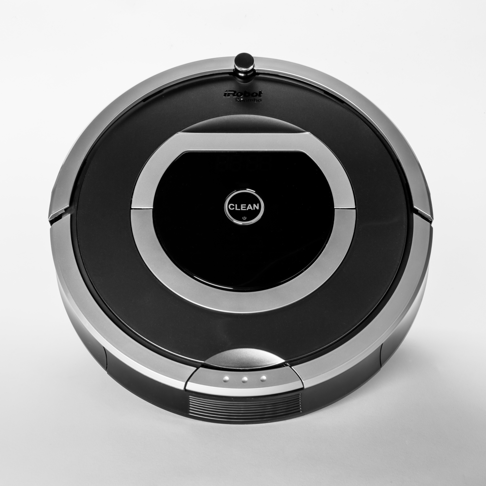

# 課題2：ロボットと充電ステーション

学校で使うロボットのバッテリーを管理します。ロボットは作業すると電力を消費し、充電ステーションから電力を受け取れます。通常のロボットと掃除ロボットでは、1回の作業に必要な電力が異なります。

クラス、継承、メソッドのオーバーライド、super()、オブジェクト同士の連携を使います。



ロボット掃除機の例。写真はイメージです。課題の消費量と充電ルールは、以下の仕様に従います。

## 実装する順番

| 順番 | ファイル | 内容 |
| --- | --- | --- |
| 1 | robot.py | Robotの状態と作業 |
| 2 | cleaning_robot.py | CleaningRobotの消費量 |
| 3 | charging_station.py | ChargingStationからRobotへの充電 |
| 4 | main.py | 完成済みのシナリオを実行して確認 |

## 1. Robot

| 属性 | 型 | 意味 |
| --- | --- | --- |
| name | str | ロボットの名前 |
| battery | int | バッテリー残量。0〜100 |

- __init__(name, battery)：受け取った値をインスタンスに保存します。
- get_work_cost()：通常の消費量である10を返します。状態は変更しません。
- work()：self.get_work_cost()で消費量を取得します。バッテリーが足りればその分を減らしてTrueを返します。足りなければ何も変更せずFalseを返します。

消費量と同じだけ残っていれば作業できます。バッテリーは0になります。work()では、消費量を10と決めつけず、メソッドから取得してください。

## 2. CleaningRobot

Robotを継承します。get_work_cost()だけをオーバーライドしてください。

super()で親クラスの消費量を取得し、掃除に必要な追加分10を加えて返します。現在の合計消費量は20です。

__init__()とwork()は継承して使い、コピーしません。親のwork()から子のget_work_cost()が呼ばれることを確認します。

## 3. ChargingStation

energy: intで、ステーションに残っているエネルギーを管理します。__init__(energy)で保存してください。

charge(robot, amount)は、受け取ったRobotまたはCleaningRobotに充電します。

| 条件 | 結果 |
| --- | --- |
| amountが0以下 | False。両方の状態を変えない |
| ステーションのenergyがamount未満 | False。両方の状態を変えない |
| 充電後にロボットのbatteryが100を超える | False。両方の状態を変えない |
| すべての条件を満たす | ステーションからamountを減らし、ロボットに同じ量を加え、Trueを返す |

一部だけ充電する処理は不要です。**すべての条件を確認してから変更してください。** メッセージを表示するだけでは、充電したことにはなりません。

初期値は正しいものとします。batteryは0〜100、energyは0以上、amountは整数です。クラスのメソッドではprintせず、戻り値と属性をmain.pyから確認します。

## 実行と結果

このフォルダー内で実行します。

```bash
python3 main.py
```

```text
R1: 作業=True, バッテリー=5
C1: 作業=False, バッテリー=15
C1へ20充電: 成功=True, バッテリー=35, ステーション=30
C1: 作業=True, バッテリー=15
R1へ40充電: 成功=False, バッテリー=5, ステーション=30
```

充電前後の合計エネルギーは変わりません。例えば、C1への充電は50＋15から30＋35への移動です。作業時は電力を消費するため、バッテリーが減ります。

## 境界の確認

次のケースも、Pythonコンソールなどで確認してください。各行は新しいオブジェクトで確認します。テストファイルの提出は不要です。

| 確認する操作 | 初期状態 | 期待する結果 |
| --- | --- | --- |
| Robotのwork() | battery=10 | True、battery=0 |
| CleaningRobotのwork() | battery=19 | False、battery=19 |
| charge(robot, 20) | energy=50、battery=80 | True、energy=30、battery=100 |
| charge(robot, 10) | energy=50、battery=95 | False、両方とも元の値 |
| charge(robot, 0)またはcharge(robot, -5) | energy=50、battery=20 | False、両方とも元の値 |
| charge(robot, 20) | energy=10、battery=20 | False、両方とも元の値 |

失敗時にenergyだけ減る、batteryだけ増えるといった状態にならないことを確認します。
